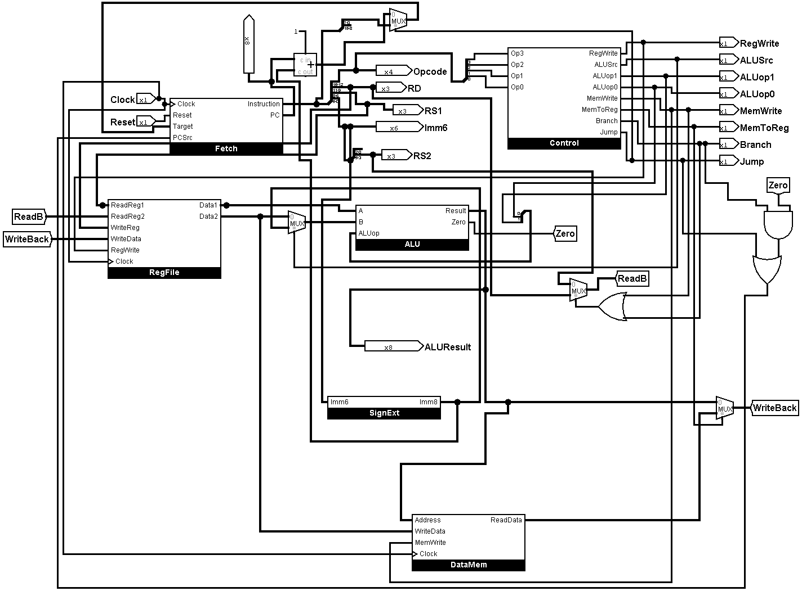

# 8-bit RISC-style CPU in Logisim, with a C assembler

A small single-cycle CPU built from logic gates in Logisim-evolution, plus an assembler written in C that turns assembly text into ROM images. The CPU fetches, decodes, and executes real programs, including loops, memory access, and branches.

> This is a custom instruction set designed for learning. It is **not** RISC-V, and RISC-V programs will not run on it.



## Specs

| Item | Value |
|------|-------|
| Data width | 8 bits |
| Instruction width | 16 bits |
| Registers | 8 (R0 to R7). R0 always reads as 0, and writes to it are ignored |
| Instruction memory | 256 x 16 ROM |
| Data memory | 256 x 8 RAM |
| Program counter | 8 bits |
| Timing | Single-cycle, rising-edge clocked |
| Instructions | 9: ADD, SUB, AND, OR, ADDI, LOAD, STORE, BEQ, JUMP |

## Instruction formats

Bit 15 is on the left.

| Type | 15..12 | 11..9 | 8..6 | 5..3 | 2..0 |
|------|--------|-------|------|------|------|
| R-type (ADD, SUB, AND, OR) | opcode | rd | rs1 | rs2 | unused |
| I-type (ADDI) | opcode | rd | rs1 | imm6 (bits 5..0) | |
| Memory (LOAD, STORE) | opcode | rd | rs1 | imm6 (bits 5..0) | |
| Branch (BEQ) | opcode | ra | rb | offset6 (bits 5..0) | |
| Jump (JUMP) | opcode | address (bits 11..0) | | | |

The 6-bit immediate is signed (-32 to 31) and is sign-extended to 8 bits. JUMP uses only the low 8 bits of its address because the PC is 8 bits wide.

## Instruction set

| Opcode | Instruction | Operation |
|--------|-------------|-----------|
| 0000 | `ADD rd, rs1, rs2` | rd = rs1 + rs2 |
| 0001 | `SUB rd, rs1, rs2` | rd = rs1 - rs2 |
| 0010 | `AND rd, rs1, rs2` | rd = rs1 & rs2 |
| 0011 | `OR rd, rs1, rs2` | rd = rs1 \| rs2 |
| 0100 | `ADDI rd, rs1, imm` | rd = rs1 + imm |
| 0101 | `LOAD rd, imm(rs1)` | rd = RAM[rs1 + imm] |
| 0110 | `STORE rd, imm(rs1)` | RAM[rs1 + imm] = rd |
| 0111 | `BEQ ra, rb, offset` | if ra == rb, PC = PC + 1 + offset |
| 1000 | `JUMP address` | PC = address |

Opcodes 1001 to 1111 are unused and decode as a no-op. An all-zero word is `ADD R0, R0, R0`, which also does nothing, so empty ROM space is harmless.

## Control signals

The control unit is a 4-input truth table (the opcode) with these outputs. It was generated in Logisim from the table below using Combinational Analysis.

| Instruction | RegWrite | ALUSrc | ALUop | MemWrite | MemToReg | Branch | Jump |
|-------------|----------|--------|-------|----------|----------|--------|------|
| ADD | 1 | 0 | 00 | 0 | 0 | 0 | 0 |
| SUB | 1 | 0 | 01 | 0 | 0 | 0 | 0 |
| AND | 1 | 0 | 10 | 0 | 0 | 0 | 0 |
| OR | 1 | 0 | 11 | 0 | 0 | 0 | 0 |
| ADDI | 1 | 1 | 00 | 0 | 0 | 0 | 0 |
| LOAD | 1 | 1 | 00 | 0 | 1 | 0 | 0 |
| STORE | 0 | 1 | 00 | 1 | 0 | 0 | 0 |
| BEQ | 0 | 0 | 01 | 0 | 0 | 1 | 0 |
| JUMP | 0 | 0 | 00 | 0 | 0 | 0 | 1 |

ALUop: 00 = add, 01 = subtract, 10 = AND, 11 = OR.

## Datapath

The top-level circuit is `CPU`. It connects these sub-circuits:

- **Fetch**: the program counter, a +1 adder, a multiplexer that picks PC + 1 or a jump/branch target, and the instruction ROM.
- **Control**: decodes the opcode into the control signals above.
- **RegFile**: seven 8-bit registers with write enables driven by a 3-to-8 decoder, plus two read multiplexers. R0 is a constant 0.
- **ALU**: an adder, a subtractor, AND, and OR, selected by a multiplexer, plus a zero flag.
- **SignExt**: sign-extends the 6-bit immediate to 8 bits.
- **DataMem**: a 256 x 8 RAM.

## Design notes

- **Second register read.** R-type instructions read their second operand from the rs2 field, but STORE and BEQ need the register in the rd field. A multiplexer on the register file's second read port selects rd when the instruction is STORE or BEQ.
- **Branching.** BEQ subtracts the two registers in the ALU and checks the zero flag. The branch target is PC + sign-extended offset + 1, computed with one adder whose carry-in is tied to 1. The PC takes the target when `Jump OR (Branch AND Zero)`.
- **Write-back.** A multiplexer controlled by MemToReg chooses between the ALU result and data read from RAM.

## Running it in Logisim

1. Install [Logisim-evolution](https://github.com/logisim-evolution/logisim-evolution).
2. Open `cpu/RISC_CPU.circ` and open the `CPU` circuit.
3. Load a program: open the `Fetch` circuit, right-click the ROM, and choose **Load Image...** to load a file produced by the assembler (or **Edit Contents** to type hex by hand).
4. Back in `CPU`, press **Ctrl+R** to reset the simulation.
5. Set `Reset` to 1, then back to 0.
6. Click `Clock` twice for each clock cycle (0 to 1 to 0), and watch the outputs.

## Test programs

Each program is in `programs/` as assembly. The `ALUResult` and `PC` outputs on the `CPU` circuit show what the CPU is doing.

| Program | Machine code | What to watch | Expected |
|---------|--------------|---------------|----------|
| `prog1.asm` (ADDI, ADD) | `4205 4403 0650` | `ALUResult` after reset, then after each tick | 5, 3, 8, 0 |
| `prog2.asm` (STORE, LOAD) | `4205 4407 6403 5603 08C8` | `ALUResult` | 5, 7, 3, 3, 12 |
| `prog3.asm` (loop with BEQ, JUMP) | `4203 427F 7041 8001 4A09 8005` | `PC` | 0, 1, 2, 3, 1, 2, 3, 1, 2, 4, 5, 5 |

In `prog2`, the final 12 shows that the value stored to RAM was loaded back into a register (7 + 5). In `prog3`, the PC loops three times until BEQ sees R1 = 0, skips the JUMP, and parks at address 5.

## Assembler

`assembler/assembler.c` reads an assembly file and prints the machine code. With a second argument, it also writes a file in Logisim's `v2.0 raw` image format.

Build and run:

```
gcc assembler/assembler.c -o assembler/assembler
./assembler/assembler programs/prog2.asm out.txt
```

Syntax:

```
ADD   R3, R1, R2      ; registers are R0 to R7
ADDI  R1, R0, 5       ; immediate is -32 to 31
STORE R2, 3(R0)
LOAD  R3, 3(R0)
BEQ   R0, R1, 1       ; skip the next instruction if R0 == R1
JUMP  5               ; address is 0 to 255
```

Comments start with `;`, and instruction names are case-insensitive. The assembler reports the line number for errors such as unknown instructions, bad registers, or out-of-range immediates, and writes nothing if there are any.

For now, jump and branch targets are written as numbers.

## Repository layout

```
cpu/RISC_CPU.circ        Logisim project
assembler/assembler.c    assembler in C
programs/                test programs (.asm)
images/cpu.png           screenshot of the CPU circuit
```

## Future work

- Labels in the assembler, so programs can say `JUMP loop` instead of counting addresses
- More instructions (XOR, shifts, set-less-than) using the free opcodes
- A Verilog version of the same CPU, checked against these test programs
- A pipelined version

## Author

Aloniab Negash, Computer Engineering
GitHub: [aloniabnegash-maker](https://github.com/aloniabnegash-maker)
Linkedin: https://www.linkedin.com/in/aloniabnegash001/
